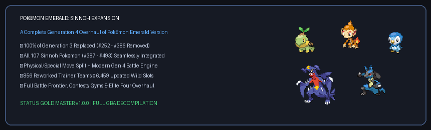
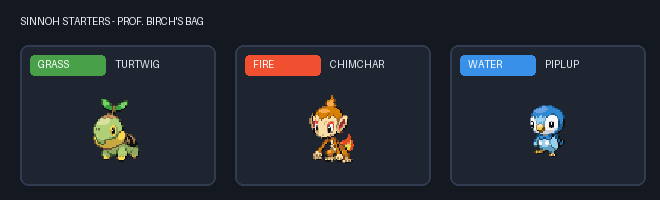
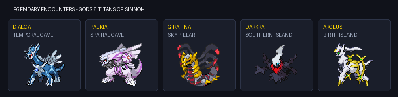

# Pokémon Emerald: Sinnoh Expansion (Gen 4 Edition)



A complete, ground-up overhaul of **Pokémon Emerald Version** built upon the modern `pokeemerald` decompilation engine. 

Every single native Generation 3 Pokémon (#252 Treecko to #386 Deoxys) has been **entirely excised from the game** and replaced with the complete **Generation 4 Sinnoh Pokédex (#387 Turtwig to #493 Arceus)**. Explore the Hoenn region reimagined with Sinnoh's ecology, revamped trainer parties, mythical encounters, and modern battle mechanics.

---

## 🌟 Key Features

### 1. The Zero-Generation 3 Policy
* **100% Elimination of Gen 3 (#252 - #386):** You will never encounter, catch, breed, or battle a Hoenn Pokémon. Every single wild encounter, trainer party, in-game trade, fossil, and static event has been cleanly migrated to Generation 4.
* **Full 107 Sinnoh Pokémon (#387 - #493):** From everyday wildlife like Starly and Bidoof to regional powerhouses like Garchomp, Lucario, and Togekiss, every Sinnoh species is obtainable throughout your journey.



### 2. Sinnoh Starters
* Professor Birch's bag under attack features the three iconic Sinnoh starter Pokémon:
  * 🌿 **Turtwig** (Grass $\rightarrow$ Grass/Ground)
  * 🔥 **Chimchar** (Fire $\rightarrow$ Fire/Fighting)
  * 💧 **Piplup** (Water $\rightarrow$ Water/Steel)
* Complete with fully animated front and back battle sprites, custom menu icons, and authentic cries.

---

### 3. Re-engineered Wild Ecology (6,459 Slots)
Every route, cave, body of water, dive trench, and tree has been rebalanced:
* **Early Routes (Routes 101–104):** Bidoof, Starly, Kricketot, and Shinx replace Wurmple, Zigzagoon, and Poochyena.
* **Forests & Canopies (Petalburg Woods):** Cherubi, Burmy (Plant, Sandy, Trash cloaks), Combee, Pachirisu, and Buneary.
* **Caves & Depths (Granite Cave, Meteor Falls, Fiery Path):** Cranidos, Shieldon, Gible, Hippopotas, Bronzor, Riolu, and Probopass.
* **Waterways & Ocean Depths:** Buizel, Floatzel, Shellos & Gastrodon (East and West Sea variants), Finneon, Lumineon, and Mantyke.
* **Safari Zone:** Rare exotic Sinnoh fauna including Carnivine, Skorupi, Drapion, Croagunk, Toxicroak, Yanmega, Tangrowth, Gliscor, Electivire, Magmortar, and Porygon-Z.

---

### 4. Overhauled Gym Leaders, Elite Four & Rivals (856 Teams)
All 856 trainer parties across the Hoenn league have been meticulously reconstructed:
* **Roxanne (Rustboro Gym):** Geodude, Cranidos, Shieldon, Probopass.
* **Brawly (Dewford Gym):** Machop, Riolu, Croagunk, Lucario.
* **Wattson (Mauville Gym):** Pachirisu, Luxio, Rotom, Electivire.
* **Flannery (Lavaridge Gym):** Monferno, Magmortar, Infernape.
* **Norman (Petalburg Gym):** Bibarel, Ambipom, Lopunny, Porygon-Z.
* **Winona (Fortree Gym):** Staraptor, Honchkrow, Gliscor, Drifblim, Togekiss.
* **Tate & Liza (Mossdeep Gym - Double Battle):** Bronzong, Gallade, Uxie, Azelf.
* **Juan & Wallace (Sootopolis Gym & Champion):** Empoleon, Floatzel, Gastrodon, Roserade, Lucario, Drapion.
* **Rivals (Brendon, May & Wally):** Fully updated rosters scaling with your progress. Wally commands his signature **Gallade** instead of Gardevoir.
* **Team Aqua & Team Magma:** Reworked with Stunky/Skuntank, Croagunk/Toxicroak, Hippopotas, and Buizel.

---



### 5. Legendary Quests & Spatial Events
* **Sky Pillar:** At the pinnacle of the pillar, the dragon ruler of the Distortion World awaits: **Giratina** (with custom battle BGM).
* **Terra & Marine Caves:** Unravel space and time with **Dialga** (Terra Cave) and **Palkia** (Marine Cave).
* **Lunar Duo (Roaming & Southern Island):**
  * Post-game TV selection (Red/Blue) unlocks a symmetric pairing between **Cresselia** and **Darkrai** (one roams Hoenn, while the other guards Southern Island).
  * Soul Dew functionality has been enhanced to empower both lunar guardians.
* **The Sealed Chamber & Braille Puzzles:** The ancient braille puzzle now unlocks using **Lumineon** and **Finneon**, opening the sanctums of **Uxie**, **Azelf**, and **Heatran**.
* **Birth Island:** Solve the triangle puzzle to summon the creator of all Pokémon: **Arceus**.

---

### 6. In-Game Gifts, Fossils & Sidequests
* **Route 120 Invisible Bridge:** Revealing the hidden obstacle with the Devon Scope triggers an encounter with the sinister **Spiritomb**.
* **Weather Institute Reward:** Receive **Rotom** as a gift from the institute scientists.
* **Steven's House (Mossdeep City):** Steven leaves behind a Poké Ball containing **Riolu**.
* **Lavaridge Hot Springs Egg:** The kind elder gifts an egg that hatches into **Happiny**.
* **Desert Fossils:** Resurrect the Skull Fossil (**Cranidos**) and Armor Fossil (**Shieldon**).
* **In-Game Trades:** All NPC trades offer Sinnoh Pokémon (Pachirisu, Cherubi, Finneon, Glameow).
* **Secondary Systems:** TV Mass Outbreaks, Mauville Game Corner roulette, the Quiz Lady, and Sootopolis Size Brothers (Cherubi & Buneary) fully aligned.

---

### 7. Battle Frontier & Contests
* **All 7 Frontier Brains (Silver & Gold):** Anabel, Tucker, Lucy, Spenser, Greta, Noland, and Brandon wield competitive Gen 4 teams (Garchomp, Empoleon, Lucario, Darkrai, Cresselia, Spiritomb, Floatzel, Dusknoir).
* **Battle Tents & Facilities:** All 291 rental and opponent sets across the Battle Factory, Battle Tower, and Battle Tents have been scrubbed of Gen 3 Pokémon.
* **Contest Opponents:** All 52 Pokémon Contest competitors feature Sinnoh Pokémon across all five categories (Cool, Beauty, Cute, Smart, Tough).

---

### 8. Modern Battle Engine Mechanics
* **Physical/Special Move Split:** Moves calculate damage based on physical or special category rather than elemental type.
* **Modern Abilities, Items & Moves:** Close Combat, Draco Meteor, Air Slash, Dawn Stone, Dusk Stone, Oval Stone, and more.
* **Quality of Life:** Indoor running, modern status screens, and responsive gameplay.

---

## 🕹️ How to Play

### Option 1: Apply the BPS Patch (Easiest)
Due to copyright regulations, pre-compiled Nintendo ROM binaries (`.gba`) cannot be hosted on public repositories. You can easily patch your own legally acquired ROM:

1. Obtain a clean copy of **Pokémon - Emerald Version (USA)** (`SHA1: f3ae088181bf583e55daf962a92bb46f4f1d07b7`).
2. Download or generate the patch file using the included script:
   ```bash
   python tools/create_bps_patch.py /path/to/clean_emerald.gba pokeemerald_sinnoh.bps
   ```
3. Apply the `.bps` patch in your web browser with 1 click at **[Rom Patcher JS](https://marcrobledo.com/RomPatcher.js/)**.
4. Load the resulting `.gba` file in any modern Game Boy Advance emulator (such as **mGBA**).

---

### Option 2: Build from Source

This repository contains the complete, compilable source code for the project.

#### Prerequisites (Windows via MSYS2)
1. Install **MSYS2** (UCRT64 environment).
2. Install the modern ARM Embedded Toolchain:
   ```bash
   pacman -S mingw-w64-ucrt-x86_64-arm-none-eabi-gcc make git
   ```

#### Compiling the ROM
1. Clone this repository:
   ```bash
   git clone https://github.com/gio961gio/pokeemerald-sinnoh-expansion.git
   cd pokeemerald-sinnoh-expansion
   ```
2. Build the tools and compile:
   ```bash
   make -j$(nproc)
   ```
3. Upon completion, your output ROM `pokeemerald.gba` will be generated in the root directory:
   * **Target:** `pokeemerald.gba`
   * **File Size:** `33,554,432 bytes (32 MB)`
   * **SHA1:** `A2254A7306C2486D0B75539FEB2C6E0C75F05896`

---

## ⚖️ Legal Disclaimer & Copyright Notice

* **No Copyrighted Game Binaries Distributed:** This repository contains **exclusively open-source code, assets, scripts, and documentation**. In strict compliance with international copyright laws and the GitHub Terms of Service, **no copyrighted commercial ROM files (`.gba`) are hosted, stored, or distributed on this repository**. The `.gitignore` configuration explicitly excludes all compiled binaries.
* **Trademarks & Intellectual Property:** *Pokémon*, *Pokémon Emerald*, Pokémon character names, and related visual assets are registered trademarks and copyrights of **Nintendo Co., Ltd.**, **Creatures Inc.**, and **Game Freak Inc.**
* **Non-Commercial Educational Project:** This project is an independent, non-commercial fan modification created strictly for educational, research, and digital preservation purposes. It is not affiliated with, endorsed by, or sponsored by Nintendo, Game Freak, or The Pokémon Company in any way.
* To play this modification, users must build the source code locally or apply a patch file onto their own lawfully acquired copy of Pokémon Emerald.

---

## 📜 Credits

* Built upon the decompilation base provided by the **[pret](https://github.com/pret/pokeemerald)** and **[RHH (Rom Hacking Hideout)](https://github.com/rh-hideout/pokeemerald-expansion)** communities.
* Modified, overhauled, and maintained by **[gio961gio](https://github.com/gio961gio)**.
